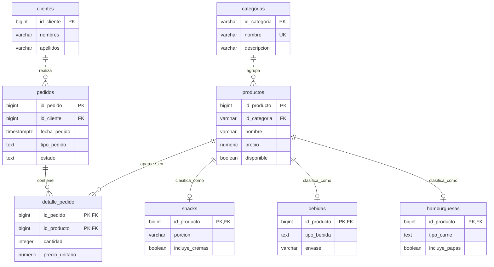

# Modelo entidad–relación de Red Pepper

El esquema `salchipaperia` tiene ocho tablas. **PK** identifica la clave primaria, **FK** marca una clave foránea y **UK** indica una restricción de unicidad.

- Cada pedido corresponde a un cliente y puede tener varias líneas. `detalle_pedido` conecta pedidos y productos. Su clave compuesta permite una fila por producto en cada pedido.
- Cada producto pertenece a una categoría. La combinación `id_categoria` y `nombre` es única en `productos`.
- Cada producto tiene exactamente un subtipo. Las tres relaciones opcionales del diagrama son excluyentes entre `snacks`, `bebidas` y `hamburguesas`.

Puedes seleccionar una entidad para ver sus claves y abrir sus filas en el [modelo interactivo](https://nexlabsgroup.com/basededatos/#modelo). El archivo [de consultas para DataGrip](sql/07_validar_datagrip.sql) incluye el inventario de tablas y ejemplos de detalle y totales.
