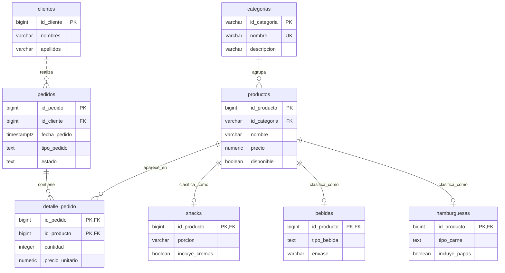

# Modelo entidad–relación de Red Pepper

El esquema `salchipaperia` tiene ocho tablas y siete vínculos por clave foránea. **PK** identifica la clave primaria, **FK** marca una clave foránea y **UK** indica una restricción de unicidad. [Instalación y comandos](README.md#paso-a-paso)

## Diagrama

## Relaciones y reglas

| Entidad de origen | Entidad relacionada | Cardinalidad | Clave foránea |
| --- | --- | --- | --- |
| Clientes | Pedidos | `1 a 0..N` | `pedidos.id_cliente` |
| Pedidos | Detalle del pedido | `1 a 0..N` | `detalle_pedido.id_pedido` |
| Productos | Detalle del pedido | `1 a 0..N` | `detalle_pedido.id_producto` |
| Categorías | Productos | `1 a 0..N` | `productos.id_categoria` |
| Productos | Snacks | `1 a 0..1` | `snacks.id_producto` |
| Productos | Bebidas | `1 a 0..1` | `bebidas.id_producto` |
| Productos | Hamburguesas | `1 a 0..1` | `hamburguesas.id_producto` |

- Cada pedido corresponde a un cliente y puede tener varias líneas. `detalle_pedido` conecta pedidos y productos. Su clave compuesta permite una fila por producto en cada pedido.
- Cada producto pertenece a una categoría. La combinación `id_categoria` y `nombre` es única en `productos`.
- Cada producto tiene exactamente un subtipo entre `snacks`, `bebidas` y `hamburguesas`. Los disparadores ejecutan `comprobar_subtipo` para verificar la regla al confirmar la transacción. [Migración vigente](sql/10_simplificar_pedidos.sql)
- El precio vigente se guarda en `productos`. El precio aplicado se guarda en `detalle_pedido` y se multiplica por la cantidad para obtener el importe de cada línea.

## Consultar el modelo

Selecciona una entidad para ver sus campos y abrir sus filas. [Mapa interactivo](https://nexlabsgroup.com/basededatos/#modelo)

Ejecuta las consultas de inventario, catálogo, detalle o totales en DataGrip. [Consultas SQL](sql/07_validar_datagrip.sql)
