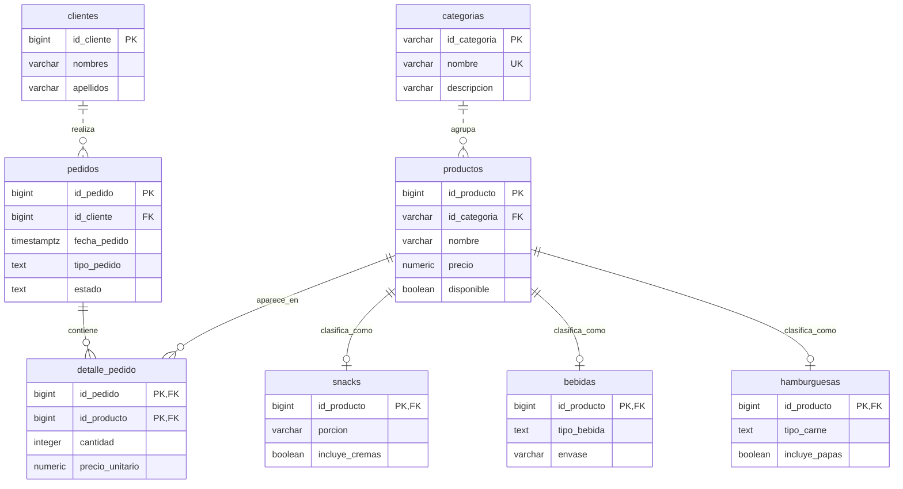

# Base de Datos · Red Pepper

Laboratorio de base de datos para la carta de Red Pepper y el recorrido de sus pedidos. El informe documenta la normalización, el catálogo, la instalación y los resultados.

- [Tablas y relaciones](#tablas-y-relaciones)
- [Informe técnico](informe/informe_red_pepper.pdf)
- [Excel de los 100 pedidos de muestra](outputs/red-pepper/ventas_red_pepper.xlsx)
- [Portal de demostración](https://nexlabsgroup.com/basededatos/)
- [Identidad y brief de diseño](BRANDING.md)
- [Diseño original del laboratorio en Stitch](https://stitch.withgoogle.com/projects/14029965516649664019)

## Tablas y relaciones

El esquema `salchipaperia` tiene ocho tablas. **PK** identifica la clave primaria, **FK** marca una clave foránea y **UK** indica una restricción de unicidad.



- Cada pedido corresponde a un cliente y puede tener varias líneas. `detalle_pedido` conecta pedidos y productos. Su clave compuesta permite una fila por producto en cada pedido.
- Cada producto pertenece a una categoría. La combinación `id_categoria` y `nombre` es única en `productos`.
- Cada producto tiene exactamente un subtipo. Las tres relaciones opcionales del diagrama son excluyentes entre `snacks`, `bebidas` y `hamburguesas`.

Puedes seleccionar una entidad para ver sus claves y abrir sus filas en el [modelo interactivo](https://nexlabsgroup.com/basededatos/#modelo). El archivo [de consultas para DataGrip](sql/07_validar_datagrip.sql) incluye el inventario de tablas y ejemplos de detalle y totales.

## 1. Base de datos

Para reproducir el esquema y la muestra desde cero, ejecutar desde la raíz del repositorio en una base de pruebas vacía. Los primeros scripts recrean la carga histórica. La migración `10` produce el esquema vigente.

```sh
psql -X -v ON_ERROR_STOP=1 -f sql/01_modelo.sql
psql -X -v ON_ERROR_STOP=1 -f sql/02_datos_demo.sql
psql -X -v ON_ERROR_STOP=1 -f sql/03_consultas.sql
psql -X -v ON_ERROR_STOP=1 -f sql/04_pruebas.sql
psql -X -v ON_ERROR_STOP=1 -f sql/06_catalogo_y_ventas.sql
psql -X -v ON_ERROR_STOP=1 -f sql/08_nombres_ficticios.sql
psql -X -v ON_ERROR_STOP=1 -f sql/09_presentaciones_y_celulares.sql
psql -X -v ON_ERROR_STOP=1 -f sql/10_simplificar_pedidos.sql
psql -X -v ON_ERROR_STOP=1 -f sql/07_validar_datagrip.sql
```

`psql` usa los parámetros de conexión del entorno. Para Supabase, tomar host, usuario y puerto de **Connect**, descargar su CA desde **Database Settings** y usar `sslmode=verify-full`. En un esquema original que ya contiene la muestra y las correcciones hasta `09`, respaldar primero `salchipaperia` y aplicar solo `10`. La migración se ejecuta como una transacción. El script `07` se puede ejecutar por bloques después de migrar.

### Resultados en PostgreSQL local y Supabase

| Muestra | Productos de carta | Pedidos | Líneas | Importe |
| --- | ---: | ---: | ---: | ---: |
| Del 24 de octubre al 22 de noviembre de 2026 | 38 | 100 | 186 | S/ 2,303.50 |

El esquema tiene ocho tablas y cero vistas. Conserva `clientes`, `categorias`, `productos`, `pedidos`, `detalle_pedido`, `snacks` y `bebidas`, y añade `hamburguesas` con las ocho variantes de res y pollo. Cada producto tiene un solo subtipo. La columna `tipo_bebida` acepta `Gaseosa` o `Chicha`. Agua y maracuyá conservan un valor `NULL` en esa columna.

La carta aporta los precios de venta sin membresía. El total se calcula multiplicando la cantidad por el precio aplicado a cada línea. `web/datos.js` contiene la muestra reproducible y `scripts/muestra_historica.mjs` completa los datos requeridos por las cargas anteriores. Ejecutar `node scripts/generar_muestra.mjs` desde la raíz para regenerar las cargas históricas `06`, `08` y `09`.

El Excel enlaza las hojas Ventas y Detalle por su código de muestra y la hoja Clientes por el identificador interno de cada cliente. Sus códigos de pedido identifican filas de la muestra de Excel. DataGrip usa la identidad de cada pedido de PostgreSQL.

### Ver el esquema en DataGrip

En **Database Explorer**, seleccionar la conexión Supabase de NexLabs y sincronizar `salchipaperia`. La base es `postgres`. Abrir una consola y ejecutar `sql/07_validar_datagrip.sql` por bloques. La consulta de inventario devuelve ocho tablas. El bloque de la muestra devuelve 100 pedidos, 186 líneas y S/ 2,303.50. Las consultas de detalle y total usan las tablas directamente.

## 2. Portal en cPanel

El directorio público es `public_html/basededatos`. Publicar allí los archivos de `web/`, incluido `.htaccess`, y una copia de `informe/informe_red_pepper.pdf` con el nombre `informe-red-pepper.pdf`. Las rutas de navegación son `/basededatos/` y `/basededatos/informe`. La interfaz puede abrirse en un servidor estático local desde la carpeta `web`. La ruta del informe utiliza el rewrite de Apache o LiteSpeed.

El portal carga la muestra como parte de su aplicación estática. Los borradores de práctica 101 y 102 permiten ensayar operaciones inmediatamente. Los cambios se guardan en el almacenamiento local del navegador. Para volver a la muestra inicial se puede usar un navegador o perfil nuevo. Supabase conserva su carga independiente en PostgreSQL.

La cabecera permite alternar entre tema claro y oscuro. El portal sigue la preferencia del sistema hasta elegir un modo y guarda la elección en el navegador. La pantalla de carga aparece mientras se prepara el laboratorio. El movimiento reducido del sistema desactiva el pulso y las transiciones.

El recorrido abre en **Guía de ventas**. Las tarjetas muestran el cliente, el pedido, el detalle y su total. Para practicar, pulsa **Nuevo pedido**, elige cliente y modalidad, agrega un producto y edita su cantidad. El panel **Qué cambió en los datos** compara las filas antes y después de la última operación. Puedes mover una línea, borrarla o deshacer el último cambio durante la sesión.

**Modelo** explica las relaciones de las ocho tablas. **Explorar tablas** permite buscar y seguir claves foráneas. **Editar pedidos** permite cambiar los datos de una comanda, sus líneas y su estado. **Resumen del pedido** muestra las unidades y el total. En el directorio `diseno/stitch/` se conserva el diseño histórico.

## 3. Archivos y verificación

| Ruta | Contenido |
| --- | --- |
| `sql/` | Modelo, datos ficticios, vistas, consultas y pruebas |
| `BRANDING.md` | Tokens de color, tipografía, iconos y brief usado en Stitch |
| `diseno/stitch/` | Exportaciones de las pantallas y de los dos temas de Stitch |
| `web/` | Portal, operaciones del laboratorio y datos de práctica |
| `scripts/generar_muestra.mjs` | Generador reproducible de la carga PostgreSQL |
| `informe/` | PDF y fuente editable LaTeX |

Para regenerar el informe, ejecutar `xelatex -halt-on-error informe/informe_red_pepper.tex` con Calibri y Consolas disponibles. Las pantallas de Stitch derivan de `BRANDING.md`. El HTML publicado adopta su navegación, retícula y componentes, con etiquetas y datos vinculados a las operaciones del laboratorio.
